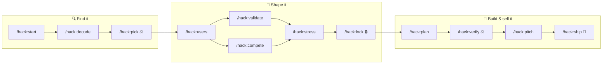
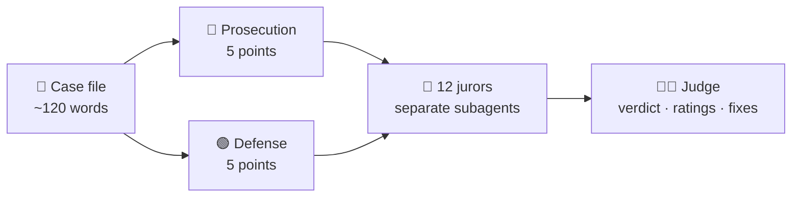

<div align="center">

# 🏁 Hack Kit

### From *"here are the problem statements"* to a locked, validated, buildable hackathon idea, in about an hour.

[](https://docs.claude.com/en/docs/claude-code/plugins)
[](CHANGELOG.md)
[](LICENSE)
[](#-commands)

**Decode the statements → pick one with a courtroom trial → think as real users → prove it's real → lock the idea → plan the MVP → pitch → one final PDF.**

### 🌐 [See it in action → syed-imadulla.github.io/hack-kit](https://syed-imadulla.github.io/hack-kit/)
<sub>An interactive walkthrough with the flow, a demo courtroom trial, and one-click install for Claude Code, the Claude app and any chat AI.</sub>

</div>

---

## Why Hack Kit?

Most hackathon teams lose in the first two hours, long before they write any code:

- They pick the problem that *sounds* cool, not the one the rubric rewards.
- They build for an imaginary user, and forget the person with a keypad phone.
- They say "no one has done this" and lose credibility in the Q&A.
- They keep changing the idea after every piece of feedback.

Hack Kit turns those two hours into a guided process. Each `/hack:` command asks your team the few questions that matter, saves the answers in a shared `.hackathon/` folder, and tells you what to run next. At two key points it puts your idea **on trial** in front of 12 independent AI jurors.

> ⚖️ **Hack Kit judges whether the problem is real and whether your solution truly solves it for real users.**
> It never judges business viability, revenue or market size.

---

## ⚡ Quick start

```bash
# 1. Install (inside Claude Code)
/plugin marketplace add syed-imadulla/hack-kit
/plugin install hack@hack-kit

# 2. See every command
/hack:help

# 3. At the hackathon
/hack:start          # read the brief like a judge
/hack:decode         # paste the problem statements
/hack:pick           # score + courtroom trial → choose one
```

If the commands don't appear, restart Claude Code.

---

## 🗺️ How it flows



⚖️ courtroom trial · 🔒 idea freeze (after this, fixes go *inside* the core) · 📄 final PDF

---

## 📋 Commands

### Find it
| Command | What it does | Saves |
|---|---|---|
| `/hack:start` | Sets up the project and reads the brief like a judge: rubric weights, limits, team, time | `BRIEF.md` `STATE.md` |
| `/hack:decode` | Decodes every statement: real problem, real user, least-digital user, hidden constraints, **obvious idea vs smarter angle** | `STATEMENTS.md` |
| `/hack:pick` ⚖️ | Rubric-weighted scoring + red flags, then a **trial** for the top 2–3. The captain decides | `PICK.md` |

### Shape it
| Command | What it does | Saves |
|---|---|---|
| `/hack:users` | Thinks as every real user. Writes the POV, How-Might-We, job story, persona and motto | `USERS.md` |
| `/hack:validate` | Sourced numbers, real complaints, a local example, a 5-minute venue interview script | `EVIDENCE.md` |
| `/hack:compete` | What already exists, an honest gap table, how you fit **alongside** existing systems | `COMPETE.md` |
| `/hack:stress` | Role-plays the domain expert and a sceptical judge. Finds the smallest fix that keeps the core | `STRESS.md` |
| `/hack:lock` 🔒 | Freezes the motto, journey, USPs, and the AI-vs-rules-vs-humans split | `CORE.md` |

### Build & sell it
| Command | What it does | Saves |
|---|---|---|
| `/hack:plan` | One-journey MVP, build/mock/cut, stack with reasons, timeline, 90-second demo, AI test cases | `PLAN.md` |
| `/hack:verify` ⚖️ | **Trial** of the solution + rubric score + mistakes check + claims check | `VERDICT.md` |
| `/hack:pitch` | Deck outline within your slide limit, one-line pitch, form answers, judge Q&A | `PITCH.md` |
| `/hack:ship` 📄 | Compiles everything into one Idea Pack | `FINAL.pdf` |

### Anytime
| Command | What it does |
|---|---|
| `/hack:status` | Phase checklist, what's locked, time to each freeze, open risks, next command |
| `/hack:court <thing>` ⚖️ | Put anything on trial: an idea, a feature, a fix, a pitch |
| `/hack:help` | Command map and quick start |

**Flag:** add `--quick` to any command for a faster version (6 jurors, shorter outputs). Quick mode turns on automatically for events under 12 hours.

---

## ⚖️ The trial



Each juror is a **separate subagent** who can't see the others' votes. Each one returns:

```json
{"juror": "Least-digital user", "vote": "NOT GUILTY", "confidence": 7,
 "reason": "A normal phone call works; counter entry if I have no phone.",
 "fix": "Demo the phone-call path, not only WhatsApp."}
```

The judge counts **only real votes**. If a juror fails, the judge re-runs just that juror and never makes up a vote.

<details>
<summary><b>👥 The 12 jurors</b> (★ = in quick mode)</summary>

| # | Juror | Asks |
|---|---|---|
| 1 ★ | Actual end user | Would I use this on a busy day? |
| 2 ★ | Least-digital user | Can I use it without an app, typing or English? |
| 3 ★ | Front-line worker | Does this add work for me or remove it? |
| 4 ★ | Domain professional | Does it respect how the work really happens? |
| 5 | Today's-workaround user | Why switch from WhatsApp or paper? |
| 6 ★ | Root-cause analyst | Does it fix the cause or only a symptom? |
| 7 | "Already exists" researcher | What's honestly different? |
| 8 | Safety & ethics reviewer | What's the worst that can go wrong? |
| 9 | Systems person | Does it fit what we already run? |
| 10 ★ | Engineer | Can it be built and demoed in time? |
| 11 | Statement-owner judge | Does it answer what was asked? |
| 12 | Sceptic | Does this really matter, and to how many people? |

No investors and no accountants, on purpose.
</details>

<details>
<summary><b>📜 What a verdict looks like</b></summary>

```
VERDICT: NOT GUILTY  (9 of 12 · avg confidence 7.3/10)

Ratings /10
  Problem is real ............. 9
  Problem matters ............. 9
  Fits the root cause ......... 8
  Works for real users ........ 7
  Fits existing systems ....... 8
  Safe ........................ 8
  Buildable & demo-able ....... 7
  Different from what exists .. 7

Top 3 fixes
  1. Show nurse time saved, not just added
  2. Demo the phone-call path, not only WhatsApp
  3. Label all impact numbers as pilot targets

Quick venue check (30 min)
  Ask 3 people to describe a symptom by voice in Kannada.
  PASS if 2 of 3 transcripts keep their exact words.

If I were your team… lead the demo with the phone call, not the dashboard.
```
</details>

---

## 🧭 The 13 rules every command follows

1. Read the brief like a judge, because rubric weights decide everything.
2. Pick a problem, not a technology.
3. Think as every real user, especially the least-digital one.
4. Prove it's real with sources, real complaints and venue chats.
5. Check what already exists. "No competitors" is never true.
6. Stress-test in place of a domain expert, then confirm with real people.
7. Lock the core. After that, fixes go inside it.
8. Fit with existing systems. No new hardware.
9. No app, no typing, the simplest device.
10. AI suggests, humans decide. Safety checks use fixed rules.
11. One complete journey for the MVP, plus one wow moment. Mock the rest and say so.
12. No unsourced numbers. Targets are labelled as targets.
13. Simple, everyday English.

---

## 📁 What you get

Everything is saved in `.hackathon/` in your project. Commit it so the whole team works from the same state.

```
.hackathon/
├── STATE.md        phase checklist, decisions, freeze times
├── BRIEF.md        rubric, limits, team, time
├── STATEMENTS.md   every statement decoded
├── PICK.md         scores + trial → the chosen statement
├── USERS.md        stakeholder views, persona, motto
├── EVIDENCE.md     sources, complaints, venue notes
├── COMPETE.md      existing solutions + gap table
├── STRESS.md       doubts + fixes
├── CORE.md         🔒 the locked idea
├── PLAN.md         MVP, stack, timeline, demo script
├── VERDICT.md      solution trial + rubric score
├── PITCH.md        deck outline + judge Q&A
├── SUMMARY.md      one-page summary
├── FINAL.pdf       📄 everything, compiled
└── court/          full trial records
```

See a worked example in [`examples/opd-saathi`](examples/opd-saathi).

---

## 💬 For teammates without Claude Code

| Option | How |
|---|---|
| **Claude app skill** | Download [`hack-kit-skill.zip`](docs/downloads/hack-kit-skill.zip) (or zip `claude-ai/hack-kit/` yourself). In Claude, upload it under **Settings → Capabilities → Skills**. Then type `hack start` in a chat. |
| **Any chat AI** | Paste [`claude-ai/PROMPT.md`](claude-ai/PROMPT.md) as the first message. |
| **Quick prompts** | Copy single prompts from [`prompts/`](prompts/README.md) for parallel research. |

The chat version simulates the jury in one conversation, so it's less independent than the subagent version.

---

## ❓ FAQ

<details>
<summary><b>How long does it take?</b></summary>

About 60–80 minutes to a locked idea for a 24-hour event, and about 2 hours for a 36-hour one. Add `--quick` if you're short on time.
</details>

<details>
<summary><b>How much usage does a trial cost?</b></summary>

A full trial uses about 15 subagent calls (2 lawyers + 12 jurors + retries). Quick mode uses about 9. `/hack:pick` can run up to 3 trials, so use `--quick` there if usage is tight.
</details>

<details>
<summary><b>Does it need web access?</b></summary>

The research steps (`decode`, `validate`, `compete`) work best with web search. Without it, Hack Kit still runs, but marks claims `UNVERIFIED` and tells you what to look up.
</details>

<details>
<summary><b>What do I need for the PDF?</b></summary>

Python 3, plus one of: Chrome/Chromium, Playwright, or pandoc with a PDF engine. If none of these is available, open `FINAL.html` and use **Print → Save as PDF**.
</details>

<details>
<summary><b>Will it pick the idea for us?</b></summary>

No. It scores, runs trials and recommends, but **the captain decides**. Every big choice is a question to your team.
</details>

<details>
<summary><b>Why no business or market judging?</b></summary>

At the idea stage, judges reward a real problem that's clearly solved. Teams that chase "market size" early often drift away from the user. If your rubric asks for business points, `/hack:pitch` covers them.
</details>

---

## 📚 More

- [`docs/GUIDE.md`](docs/GUIDE.md): the full playbook (before, during, after, how to read verdicts, the mistakes we made)
- [`CHANGELOG.md`](CHANGELOG.md)
- [`CONTRIBUTING.md`](CONTRIBUTING.md)

<details>
<summary><b>Repo layout</b></summary>

```
hack-kit/
├── .claude-plugin/     plugin.json · marketplace.json
├── commands/           15 /hack: commands
├── agents/             hack-juror · hack-prosecutor · hack-defender
├── skills/
│   ├── hack-kit/       shared rules
│   └── hack-court/     trial protocol + jurors.json
├── templates/          one template per output file
├── scripts/            compile.py (FINAL.pdf) · build_skill_zip.sh
├── claude-ai/          one-chat skill + one-paste prompt
├── prompts/            copy-ready prompts
├── docs/              website (index.html) · GUIDE.md · skill zip
└── examples/           OPD Saathi sample
```
</details>

---

## 🙏 Credits

Built by **Team Udaan**, from what we learned making *OPD Saathi* for the Healthcare AI Agents track.

The trial format was inspired by court-style review skills such as [alexyc9381/court-skill](https://github.com/alexyc9381/court-skill) (MIT), and adapted to judge problems and solutions instead of business. The phase-by-phase flow was inspired by spec-driven workflows like GSD.

## 📄 License

Hack Kit is open source under the **[MIT License](LICENSE)**. You're free to use, copy, modify and share it, including in your own hackathon projects, as long as you keep the copyright notice.

<sub>© 2026 Team Udaan · Made for hackers who want to solve real problems.</sub>
