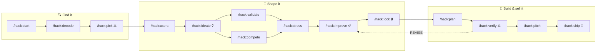
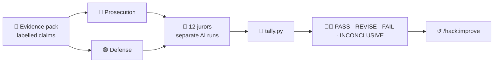

<div align="center">

# 🏁 Hack Kit

### Think deeper. Challenge harder. Build smarter.

A Claude Code plugin that takes your hackathon team from *"here are the problem statements"* to a **tested idea, an MVP plan, a pitch and one final PDF**, and tells you honestly where the idea is weak before the judges do.

[](https://docs.claude.com/en/docs/claude-code/plugins)
[](CHANGELOG.md)
[](https://github.com/syed-imadulla/hack-kit/actions/workflows/check.yml)
[](LICENSE)
[](#-commands)

### 🌐 [See it in action → syed-imadulla.github.io/hack-kit](https://syed-imadulla.github.io/hack-kit/)

</div>

---

## 🎯 What you get

In about **90 minutes** at a 24-hour hackathon (45 for a 12-hour one):

| You end up with | Instead of |
|---|---|
| ✅ The problem the **rubric rewards**, chosen with scores and a trial | The one that sounded cool |
| ✅ An idea picked from **3–6 genuinely different directions** | The first idea, the one every team builds |
| ✅ A persona, including the **least-digital user** | An imaginary user with a new smartphone |
| ✅ A list of **what you're assuming**, ranked by "does the idea collapse if this is false?" | Guesses treated as facts |
| ✅ A **verdict** from a jury of AI personas: PASS, REVISE, FAIL or INCONCLUSIVE, with ranked fixes | Finding the weak spot on stage |
| ✅ A **team-aware build plan**: owners, critical path, overload warnings | "Let's just start coding" |
| ✅ A pitch, judge Q&A and **practice with simulated judges** | A deck written at 5 a.m. |
| ✅ One **PDF Idea Pack** with every decision and why | Notes scattered across chats |

Everything is saved in a shared `.hackathon/` folder, so the whole team works from the same state.

> ⚖️ Hack Kit judges whether the problem is real and whether your solution truly solves it for real users. It never judges business viability, revenue or market size.

---

## 👀 A real run, start to finish

This is what Hack Kit produced on its own test run: a mock 24-hour hackathon with 3 problem statements. Every number below comes from the [full test project](examples/test-run-certificates/.hackathon).

**1. Pick the problem.** Three statements were scored against the rubric, then the top two went on trial.

```
| Statement         | Score | Red flag                                      |
| S2 Certificates   | 74    | none                                          |
| S1 Farm prices    | 67    | existing price lines (Kisan Call Centre)      |
| S3 Reading levels | 61    | children's regional speech recognition risky  |

Decision: REVISE · NOT GUILTY 4 · GUILTY 0 · INSUFFICIENT EVIDENCE 2
Riskiest assumption: document problems cause most rejections
```

**2. Think as the real user.** Persona: *Lakshmi, 19, applying for an income certificate for a scholarship.* Motto: **"One trip, not three."**

**3. Explore different ideas.** 13 ideas from 6 directions. The team chose a "ready-to-submit" check on the operator's existing scans plus a spoken Kannada checklist, not the obvious new app.

**4. Plan with the real team.** The plan checker read the task table and warned:

```
Critical path: T3 → T4 → T5 → T7 → T12 (14 h of 18 h to code freeze)
Load: a 10.5 h · b 7 h · c 9 h · d 8.5 h
⚠ Critical path is 78% of the time left: tight. Start the path first, and pick what to mock if it slips.
```

**5. Judge what was actually built.** A small prototype went before the **Demo Day Court**: 7 jurors, each a separate AI run.

```
Decision: FAIL · NOT GUILTY 0 · GUILTY 7
Why (7 of 7): the pitch said "voice is pre-recorded", but no recording existed yet.
Why (7 of 7): document reading was mocked; no real scan went end to end.
Why (6 of 7): the main assumption was never tested with real operators.
```

**6. Practise the hard questions.** The pitch drill asked: *"Show me a real document going through. Is the reading live?"* The team's answer, "Yes, it reads the scans", scored **1/5 for honesty**. The suggested answer came from the team's own files: *"Reading is simulated today; the rules, masking and log run live."*

**The result:** the team knew exactly what to fix and what to say about mocks, hours before judging. That is the point of Hack Kit.

---

## ⚡ Quick start

```bash
# Inside Claude Code
/plugin marketplace add syed-imadulla/hack-kit
/plugin install hack@hack-kit
/hack:help
```

Then, at the hackathon, run `/hack:start` and follow the "Next →" line each command gives you.

Updating? `/plugin marketplace update hack-kit`. Old projects upgrade automatically ([MIGRATION.md](MIGRATION.md)).

### 🌱 First hackathon? Use the starter path

Five commands, start to finish:

```
/hack:start  →  /hack:pick  →  /hack:ideate  →  /hack:plan  →  /hack:pitch     (then /hack:ship for the PDF)
```

| Command | What it does on the starter path |
|---|---|
| `/hack:start` | Reads the brief like a judge and sets your event profile |
| `/hack:pick` | Decodes every statement, then picks the problem with **one quick trial** (about 9 agent runs) |
| `/hack:ideate` | Who the users are, 3 solution directions, who already does it; the team picks |
| `/hack:plan` | Riskiest assumptions, a quick stress check, **locks the idea**, then the build plan |
| `/hack:pitch` | Deck outline, judge Q&A, and practice with `--drill` |

It's the default for first-time teams. Nothing is dropped: the other phases run as short versions inside these commands, and `/hack:status --path full` opens all 14 phases anytime without losing work.

---

## 🗺️ How it flows (full path)



⚖️ Hack Court trial · 💡 different directions · ↺ improve loop · 🔒 idea freeze · 📄 final PDF

---

## 📋 Commands

### Find it
| Command | What it does | Saves |
|---|---|---|
| `/hack:start` | Reads the brief like a judge; sets the **event profile** (type, length, team experience, focus, path) | `BRIEF.md` `STATE.md` |
| `/hack:decode` | Every statement decoded: real problem, real user, least-digital user, hidden constraints | `STATEMENTS.md` |
| `/hack:pick` ⚖️ | Rubric-weighted scoring, red flags, a trial for the top 2–3; the captain decides | `PICK.md` |

### Shape it
| Command | What it does | Saves |
|---|---|---|
| `/hack:users` | Thinks as every real user: POV, persona, motto | `USERS.md` |
| `/hack:ideate` 💡 | 6 solution directions plus "what if there's no app?"; scores the trade-offs | `IDEAS.md` |
| `/hack:validate` | Labelled evidence and **experiment cards** for the riskiest assumptions | `EVIDENCE.md` |
| `/hack:compete` | What already exists, what it fails to do, how you're different | `COMPETE.md` |
| `/hack:stress` | Role-plays the expert, front-line worker, least-digital user and sceptic | `STRESS.md` |
| `/hack:improve` ↺ | Turns feedback into a better version, without drifting from the problem | `IMPROVE.md` |
| `/hack:lock` 🔒 | Freezes the problem, main user, journey and motto | `CORE.md` |

### Build & sell it
| Command | What it does | Saves |
|---|---|---|
| `/hack:plan` | One-journey MVP, build/mock/cut, **team-aware tasks**, demo script, AI test cases | `PLAN.md` |
| `/hack:verify` ⚖️ | Trial of the planned solution and a rubric estimate. `--demo`: **Demo Day Court** on what you built | `VERDICT.md` `DEMO.md` |
| `/hack:pitch` | Deck within your slide limit, form answers, judge Q&A. `--drill`: simulated judging panel | `PITCH.md` |
| `/hack:ship` 📄 | Compiles everything into one Idea Pack (plus a short brief pack for mentors) | `FINAL.pdf` |

### Anytime
| Command | What it does |
|---|---|
| `/hack:assumptions` | What you believe but haven't proven, ranked by a kill test |
| `/hack:court <thing>` ⚖️ | Put anything on trial: an idea, a feature, a fix, a pitch |
| `/hack:status` | Where you are, what's next, time to each freeze. `--merge`: combine teammates' work. `--path`: switch path |
| `/hack:help` | Command map and quick start |
| `/hack:retro` | After the event: planned vs built vs shown, and lessons backed by your own files |

**Flags:** `--quick` on any command for a faster version (7 jurors, fewer ideas). Your event profile also sets the depth automatically: a 12-hour ideathon gets quick juries and fewer questions; a 48-hour SIH final gets full juries and deeper research.

---

## ⚖️ Hack Court



Each juror is a **separate AI run** that can't see the others: the end user, the least-digital user, the front-line worker, a domain professional, the engineer, the sceptic and more (7 in quick mode). For healthcare, agriculture, education, finance, civic and climate problems, three seats become domain experts. Every juror returns a structured vote:

```json
{"juror": "Least-digital user", "vote": "NOT GUILTY", "confidence": 7,
 "evidence_strength": "medium",
 "reason": "A normal phone call works; counter entry if I have no phone.",
 "weakest_assumption": "Patients will speak symptoms clearly on a call.",
 "fix": {"change": "Demo the phone-call path, not only WhatsApp.", "impact": "high", "effort": "low"}}
```

Raw votes are saved unedited, and `scripts/tally.py` counts them with fixed rules:

| Decision | When |
|---|---|
| **PASS** | NOT GUILTY ≥ 75% of valid votes, evidence isn't mostly weak, and no "collapses" assumption is untested |
| **REVISE** | Anything in between |
| **FAIL** | GUILTY outnumbers NOT GUILTY |
| **INCONCLUSIVE** | Too few valid votes, or more than 1/3 say "insufficient evidence" |

The verdict adds ranked fixes, the weakest assumption and the next 30-minute experiment. **It's advice; the captain decides.** Jurors are simulated perspectives, not real experts.

### 🏷️ Evidence labels

Every claim carries a label, so a confident AI guess is never mistaken for a fact:

| `[V]` Verified | `[T]` Team-provided | `[AI]` AI inference | `[?]` Unknown |
|---|---|---|---|
| Source opened and read, or measured | Said or typed by the team | Reasoning or estimate | Needed, but nobody knows yet |

Only `[V]` and `[T]` can prove an assumption. The AI never fills in interview results.

---

## 📁 What gets saved

```
.hackathon/
├── STATE.md        where you are, every decision and what was rejected
├── BRIEF.md        rubric, limits, team, time
├── PICK.md         chosen problem + trial
├── IDEAS.md        directions explored, scores, rejected ideas
├── ASSUMPTIONS.md  what you're assuming, kill test, status
├── CORE.md         🔒 the locked idea (versioned)
├── PLAN.md         MVP, tasks, demo script, fallbacks
├── DEMO.md         planned → built → tested → shown
├── PITCH.md        deck, Q&A, drill scores
├── FINAL.pdf       📄 everything in one file
└── court/          full trial records + raw votes
```

The full list is in the [guide](docs/GUIDE.md#what-gets-saved).

---

## 🧪 Tested honestly

Every release was run end to end, with each juror as a separate AI run, and every run found real problems that were then fixed:

- **v1.0:** all 14 phases on a mock hackathon, 48 separate agent runs for the trials, 11 problems found and fixed.
- **v1.1:** the Demo Day Court and drill on a real prototype, 4 more problems fixed.
- **v1.2.2:** a real Demo Day Court failed the PDS example's prototype **0–7** and caught 2 bugs that a made-up jury had passed 12–0.

Read the [test report](docs/TEST-RUN.md), or browse the [worked examples](examples/).

---

## 💬 For teammates without Claude Code

| Option | How |
|---|---|
| **Claude app** | Upload [`hack-kit-skill.zip`](docs/downloads/hack-kit-skill.zip) under **Settings → Capabilities → Skills**, then type `hack start` |
| **Any chat AI** | Paste [`claude-ai/PROMPT.md`](claude-ai/PROMPT.md) as your first message |
| **Single prompts** | Copy from [`prompts/`](prompts/README.md) for parallel research |

The app version is generated from the plugin, so both follow the same rules. Its jury runs in one chat, so it's less independent.

---

## ❓ FAQ

<details>
<summary><b>Will it pick the idea for us?</b></summary>

No. It shows the trade-offs and asks; **the captain decides** every big choice.
</details>

<details>
<summary><b>How much usage does a trial cost?</b></summary>

About 15 agent runs for a full trial, about 9 in quick mode. The starter path runs only one quick trial. Hack Kit tells you the cost before each trial.
</details>

<details>
<summary><b>Can we trust the verdict?</b></summary>

Use it to decide what to test and fix, not as proof. Real validation comes from talking to real people; that's what the experiment cards are for.
</details>

<details>
<summary><b>Does it need web access? What about the PDF?</b></summary>

Research works best with web search; without it, claims are labelled `[?]` or `[AI]`. The PDF needs Python 3 plus Chrome, Playwright or pandoc, or you can print `FINAL.html` to PDF.
</details>

More answers, the 17 rules every command follows and the full juror list are in the [guide](docs/GUIDE.md).

---

## 📚 Learn more

- [`docs/GUIDE.md`](docs/GUIDE.md): the playbook: timeline, team tips, the 17 rules, jurors, FAQ
- [`docs/TEST-RUN.md`](docs/TEST-RUN.md): every test run, with what broke and how it was fixed
- [`examples/`](examples/): complete projects with real trial records
- [`CHANGELOG.md`](CHANGELOG.md) · [`MIGRATION.md`](MIGRATION.md) · [`CONTRIBUTING.md`](CONTRIBUTING.md)

---

## 🙏 Credits

Built by **[Syed Imadulla](https://github.com/syed-imadulla)**, from what I learned making *OPD Saathi* for the Healthcare AI Agents track. The trial format was inspired by court-style review skills such as [alexyc9381/court-skill](https://github.com/alexyc9381/court-skill) (MIT), adapted to judge problems and solutions instead of business. The phase-by-phase flow was inspired by spec-driven workflows like GSD.

## 📄 License

Open source under the **[MIT License](LICENSE)**. Use, copy, modify and share it, including in your own hackathon projects, as long as you keep the copyright notice.

<sub>© 2026 Syed Imadulla · Made for hackers who want to solve real problems.</sub>
