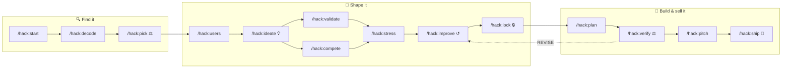
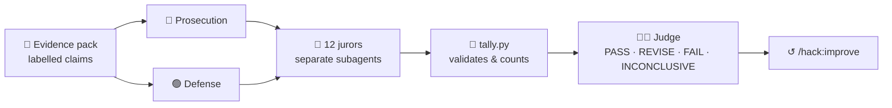

<div align="center">

# 🏁 Hack Kit

### Think deeper. Challenge harder. Build smarter.

From *"here are the problem statements"* to a well-explored, evidence-labelled, challenged and buildable hackathon idea, with an MVP plan, a pitch and one final PDF.

[](https://docs.claude.com/en/docs/claude-code/plugins)
[](CHANGELOG.md)
[](https://github.com/syed-imadulla/hack-kit/actions/workflows/check.yml)
[](LICENSE)
[](#-commands)

**Decode → pick the problem → think as real users → explore different ideas → test assumptions → challenge in Hack Court → improve → lock → plan → pitch → one final PDF.**

### 🌐 [See it in action → syedimadulla.me/hack-kit](https://syedimadulla.me/hack-kit/)
<sub>An interactive walkthrough with the flow, a demo Hack Court trial, and one-click install for Claude Code, the Claude app and any chat AI.</sub>

</div>

---

## Why Hack Kit?

Most hackathon teams lose in the first two hours, long before they write any code:

- They pick the problem that *sounds* cool, not the one the rubric rewards.
- They build the first idea they think of, the same one most other teams build.
- They build for an imaginary user, and forget the person with a keypad phone.
- They treat guesses as facts, and nobody tests the belief the whole idea rests on.
- They keep changing the idea after every piece of feedback.

Hack Kit turns those two hours into a guided process. Each `/hack:` command asks your team the few questions that matter, saves the answers in a shared `.hackathon/` folder, and tells you what to run next. It explores **genuinely different solution directions**, tracks **what you're assuming**, labels **every claim by how well it's backed**, and puts your idea **on trial** in front of 12 independent AI jurors. Then it helps you **improve** the idea without drifting from the problem.

> ⚖️ **Hack Kit judges whether the problem is real and whether your solution truly solves it for real users.** It never judges business viability, revenue or market size.

---

## ⚡ Quick start

```bash
# 1. Install (inside Claude Code)
/plugin marketplace add syed-imadulla/hack-kit
/plugin install hack@hack-kit

# 2. See every command
/hack:help

# 3. At the hackathon
/hack:start          # read the brief like a judge
/hack:decode         # paste the problem statements
/hack:pick           # choose the problem (with a trial)
/hack:ideate         # explore different ways to solve it
```

Already on 0.x? Update with `/plugin marketplace update hack-kit`. Old `.hackathon/` projects upgrade automatically; see [MIGRATION.md](MIGRATION.md).

> 🧪 **Tested end to end:** v1.0 was run through all 14 phases on a mock 24 h hackathon, with 48 real juror subagents. The run found 11 problems, and all are fixed in v1.0.1. v1.1's Demo Day Court and drill were then tested on a real prototype, which found 4 more problems, all fixed in v1.1.0. Read the [test report](docs/TEST-RUN.md) or browse the [full test project](examples/test-run-certificates/.hackathon).

---

## 🗺️ How it flows



💡 explore directions · ⚖️ Hack Court · ↺ improve loop · 🔒 protects problem, user, journey and motto · 📄 final PDF
`/hack:assumptions` runs anytime and is updated by every phase.

---

## 📋 Commands

### Find it
| Command | What it does | Saves |
|---|---|---|
| `/hack:start` | Sets up the project, picks an **event profile** (type, length, team experience, judging focus) and reads the brief like a judge | `BRIEF.md` `STATE.md` |
| `/hack:decode` | Decodes every statement: real problem, severity, real user, least-digital user, hidden constraints | `STATEMENTS.md` |
| `/hack:pick` ⚖️ | Chooses the **problem**: rubric-weighted scoring, red flags, a trial for the top 2–3, the captain decides | `PICK.md` |

### Shape it
| Command | What it does | Saves |
|---|---|---|
| `/hack:users` | Thinks as every real user. Writes the POV, How-Might-We, persona and motto | `USERS.md` |
| `/hack:ideate` 💡 | Explores **6 solution directions** plus constraint removal (no AI? no app?), scores the trade-offs, and lets the team pick | `IDEAS.md` |
| `/hack:validate` | Labelled evidence, real complaints, **experiment cards** for the riskiest assumptions, a venue interview script | `EVIDENCE.md` |
| `/hack:compete` | What exists, what it fails to solve, a differentiation statement based on user value | `COMPETE.md` |
| `/hack:stress` | Role-plays the expert, front-line worker, least-digital user, sceptic and admin. Finds failure scenarios. Drafts CORE v1 | `STRESS.md` |
| `/hack:improve` ↺ | Turns feedback into a **better version**: reasons for each change, a no-drift guardrail, team approval, a quick re-trial | `IMPROVE.md` |
| `/hack:lock` 🔒 | Protects the problem, main user, journey and motto. Warns about untested "collapses" assumptions | `CORE.md` |

### Build & sell it
| Command | What it does | Saves |
|---|---|---|
| `/hack:plan` | One-journey MVP, build/mock/cut, **team-aware tasks** (owners, skills, hours, critical path, overload check), timeline, failure scenarios, 90-second demo, AI test cases | `PLAN.md` |
| `/hack:verify` ⚖️ | **Trial** of the planned solution + rubric estimate + mistakes, claims and assumptions checks. `--demo`: **Demo Day Court** on what you actually built | `VERDICT.md` `DEMO.md` |
| `/hack:pitch` | Deck outline within your slide limit, one-line pitch, form answers, judge Q&A. `--drill`: a **simulated judging panel** to practise hard questions | `PITCH.md` |
| `/hack:ship` 📄 | Compiles everything into one Idea Pack | `FINAL.pdf` |

### Anytime
| Command | What it does |
|---|---|
| `/hack:assumptions` | What you believe but haven't proven. A **kill test** ranks what to test first |
| `/hack:court <thing>` ⚖️ | Put anything on trial: an idea, a feature, a fix, a pitch |
| `/hack:status` | Phase table, CORE version, latest decision, open assumptions, task progress, time to each freeze. `--merge`: the captain merges teammates' pending work |
| `/hack:help` | Command map and quick start |
| `/hack:retro` | Post-hackathon retrospective: connects unvalidated assumptions to demo failures, analyzes planning load, and extracts top 3 engineering lessons | `RETRO.md` |

**Flags:** `--quick` on any command gives a faster version (7 jurors, fewer ideas, one improve round). `--demo` on `/hack:verify`, `--drill` on `/hack:pitch`, `--merge` on `/hack:status`.

**Event profiles (v1.1):** your answers in `/hack:start` set how deep every command goes. A 12 h ideathon for beginners gets quick juries, fewer questions and no plan phase; a 48 h SIH final gets full juries, deeper research and the problem-statement owner on the jury. The profile is a table in `STATE.md`, so you can see and change it.

---

## 🏷️ Evidence labels

Every claim that matters carries a label, so a confident AI guess is never mistaken for a fact.

| Label | Means |
|---|---|
| `[V]` | **Verified:** a source that was opened and read (link + date), or a measured result |
| `[T]` | **Team-provided:** something the team said, or venue notes they typed |
| `[AI]` | **AI inference:** reasoning or an estimate. It can suggest, never prove |
| `[?]` | **Unknown:** needed, but nobody knows yet |

Only `[V]` and `[T]` can mark an assumption as validated, and the AI can never fill in interview results.

---

## ⚖️ Hack Court 2.0



Each juror is a **separate subagent** who can't see the others. Each votes **GUILTY**, **NOT GUILTY** or **INSUFFICIENT EVIDENCE**:

```json
{"juror": "Least-digital user", "vote": "NOT GUILTY", "confidence": 7,
 "evidence_strength": "medium",
 "reason": "A normal phone call works; counter entry if I have no phone.",
 "weakest_assumption": "Patients will speak symptoms clearly on a call.",
 "missing_info": "Call success rate in a noisy OPD.",
 "fix": {"change": "Demo the phone-call path, not only WhatsApp.", "impact": "high", "effort": "low"}}
```

Raw votes are saved unedited. `scripts/tally.py` checks every reply, so a broken reply is re-run, never guessed. It counts only valid votes and applies the decision rule:

| Decision | Rule |
|---|---|
| **INCONCLUSIVE** | fewer than 2/3 valid votes, or more than 1/3 say INSUFFICIENT EVIDENCE |
| **FAIL** | GUILTY outnumbers NOT GUILTY |
| **PASS** | NOT GUILTY ≥ 75% of all valid votes, and evidence isn't mostly weak |
| **REVISE** | anything else, **or** a PASS while a "collapses" assumption is still untested |

The judge can only move the decision **stricter**, never more lenient. The verdict adds:
- contradictions between jurors;
- 8 ratings out of 10;
- what's genuinely strong;
- the weakest assumption, with the kill test;
- what you're overlooking, and an alternative approach;
- ranked improvements by impact ÷ effort;
- the next 30-minute experiment.

<details>
<summary><b>👥 The 12 jurors</b> (★ = quick mode) and domain seats</summary>

| # | Juror | Asks |
|---|---|---|
| 1 ★ | Actual end user | Would I use this on a busy day? |
| 2 ★ | Least-digital user | Can I use it without an app, typing or English? |
| 3 ★ | Front-line worker | Does this add work for me or remove it? |
| 4 ★ | Domain professional | Does it respect how the work really happens? |
| 5 | Today's-workaround user | Why switch from WhatsApp or paper? |
| 6 ★ | Root-cause analyst | Does it fix the cause or only a symptom? |
| 7 | "Already exists" researcher | What's honestly different? |
| 8 | Safety & ethics reviewer | What's the worst that can go wrong? |
| 9 | Systems person | Does it fit what we already run? |
| 10 ★ | Engineer | Can it be built and demoed in time? |
| 11 | Statement-owner judge | Does it answer what was asked? |
| 12 ★ | Sceptic | Does this really matter, and to how many people? |

**Domain seats:** for healthcare, agriculture, education, finance, civic and climate problems, seats 4, 5 and 9 become three domain jurors. For healthcare, that's a senior doctor, a hospital administrator and a patient privacy officer. The jury stays at 12, so the cost doesn't change.

No investors and no accountants, on purpose. Simulated jurors are perspectives, not real experts, and confidence isn't a probability of success.
</details>

---

## 🧭 The 17 rules every command follows

1. Read the brief like a judge, because rubric weights decide everything.
2. Pick a problem, not a technology.
3. Think as every real user, especially the least-digital one.
4. Prove it's real with sources, real complaints and venue chats.
5. Check what already exists. "No competitors" is never true.
6. Stress-test in place of a domain expert, then confirm with real people.
7. Lock the core (problem, user, journey, motto). Details can still improve.
8. Fit with existing systems. No new hardware.
9. No app, no typing, the simplest device.
10. AI suggests, humans decide. Safety checks use fixed rules.
11. One complete journey for the MVP. Every feature needs a reason.
12. No unlabelled numbers. Targets are labelled as targets.
13. Simple, everyday English.
14. **Evidence before confidence.** A confident AI answer is still `[AI]`.
15. **Test the riskiest assumption first.**
16. **Different technology isn't innovation.** Differentiate by user value.
17. **Keep the decision history.** Record what was rejected, and why.

---

## 📁 What you get

Everything is saved in `.hackathon/` in your project. Commit it so the whole team works from the same state.

```
.hackathon/
├── STATE.md        schema v2: phases, decisions (incl. rejected), locked items
├── BRIEF.md        rubric, limits, team, time
├── STATEMENTS.md   every statement decoded
├── PICK.md         chosen problem + trial
├── USERS.md        stakeholder views, persona, motto
├── IDEAS.md        💡 directions explored, scores, rejected ideas
├── ASSUMPTIONS.md  what you're assuming, kill test, status
├── EVIDENCE.md     labelled evidence, experiment cards
├── COMPETE.md      what exists + differentiation
├── STRESS.md       doubts + failure scenarios
├── IMPROVE.md      ↺ improvement rounds, v1 → v2
├── CORE.md         🔒 the locked idea (versioned)
├── PLAN.md         MVP, demo script, fallbacks
├── VERDICT.md      solution trial + rubric estimate
├── PITCH.md        deck + Q&A
├── SUMMARY.md      one page
├── FINAL.pdf       📄 everything
├── history/        earlier versions, never deleted
└── court/          full trial records + raw votes
```

Worked examples: [`examples/test-run-certificates`](examples/test-run-certificates) (every file, plus real trial records) and [`examples/opd-saathi`](examples/opd-saathi).

Share the short version with mentors: `/hack:ship` also makes a **brief pack** (about 10–15 pages).

---

## 💬 For teammates without Claude Code

| Option | How |
|---|---|
| **Claude app skill** | Download [`hack-kit-skill.zip`](docs/downloads/hack-kit-skill.zip). In Claude, upload it under **Settings → Capabilities → Skills**. Then type `hack start`. It includes every phase's full instructions. |
| **Any chat AI** | Paste [`claude-ai/PROMPT.md`](claude-ai/PROMPT.md) as the first message. |
| **Quick prompts** | Copy single prompts from [`prompts/`](prompts/README.md) for parallel research. |

The app skill is **generated from the plugin**, so both follow the same rules. Its jury is simulated in one chat, so it's less independent than the subagent version.

---

## ❓ FAQ

<details>
<summary><b>How long does it take?</b></summary>

About 80–100 minutes to a locked idea for a 24-hour event, and about 45 minutes in quick mode for a 12-hour one. The time guard shrinks the new thinking steps when time is short.
</details>

<details>
<summary><b>How much usage does a trial cost?</b></summary>

A full trial uses about 15 subagent calls (2 lawyers + 12 jurors + retries). Quick mode uses about 10. `/hack:improve` runs one quick re-trial per round.
</details>

<details>
<summary><b>Will it pick the idea for us?</b></summary>

No. `/hack:ideate` shows the trade-offs and the captain decides. The AI never picks the most impressive-sounding idea for you.
</details>

<details>
<summary><b>Can we trust the verdict?</b></summary>

Use it to decide what to test and fix, not as proof. Jurors are simulated perspectives, confidence isn't a probability, and only `[V]` and `[T]` evidence counts as real. Real validation comes from the experiments you run.
</details>

<details>
<summary><b>Does it need web access?</b></summary>

The research steps work best with web search. Without it, Hack Kit still runs, but labels claims `[?]` or `[AI]` and tells you what to look up.
</details>

<details>
<summary><b>What do I need for the PDF?</b></summary>

Python 3, plus Chrome/Chromium, Playwright or pandoc. Otherwise, open `FINAL.html` and use **Print → Save as PDF**.
</details>

<details>
<summary><b>Why no business or market judging?</b></summary>

At the idea stage, judges reward a real problem that's clearly solved. If your rubric asks for business points, `/hack:pitch` covers them.
</details>

---

## 🗓️ Roadmap

- **v1.0, "Think deeper":** ideate, Hack Court 2.0, the improve loop, assumptions, evidence labels, automated checks.
- **v1.1 (this release), "Build smarter":** full event profiles, Demo Day Court (`/hack:verify --demo`), team-aware plans, pitch drills, safe parallel work.
- **v1.2, "Show it":** a complete example Idea Pack, a website idea-evolution demo, a post-event retro command.

---

## 📚 More

- [`docs/GUIDE.md`](docs/GUIDE.md): the full playbook (before, during and after the event)
- [`docs/TEST-RUN.md`](docs/TEST-RUN.md): the first end-to-end test run, with timings and fixes
- [`MIGRATION.md`](MIGRATION.md): upgrading from 0.x
- [`CHANGELOG.md`](CHANGELOG.md) · [`CONTRIBUTING.md`](CONTRIBUTING.md)

<details>
<summary><b>Repo layout</b></summary>

```
hack-kit/
├── .claude-plugin/     plugin.json · marketplace.json
├── .github/workflows/  checks on every push
├── commands/           19 /hack: commands
├── agents/             hack-juror · hack-prosecutor · hack-defender
├── skills/
│   ├── hack-kit/       shared rules (the source of truth)
│   └── hack-court/     trial protocol + jurors.json (with domain seats)
├── templates/          one template per output file
├── scripts/            check.py · tally.py · compile.py · lint_project.py · build_claude_ai.py
├── tests/              vote-counter tests and fixtures
├── claude-ai/          generated Claude app skill + one-paste prompt
├── prompts/            copy-ready prompts
├── docs/               website · GUIDE.md · TEST-RUN.md · skill zip
└── examples/           test run (complete) · OPD Saathi sample
```
</details>

---

## 🙏 Credits

Built by **[Syed Imadulla](https://github.com/syed-imadulla)**, from what I learned making *OPD Saathi* for the Healthcare AI Agents track. Version 1.0 was shaped by independent reviews of v0.3.

The trial format was inspired by court-style review skills such as [alexyc9381/court-skill](https://github.com/alexyc9381/court-skill) (MIT), and adapted to judge problems and solutions instead of business. The phase-by-phase flow was inspired by spec-driven workflows like GSD.

## 📄 License

Hack Kit is open source under the **[MIT License](LICENSE)**. You're free to use, copy, modify and share it, including in your own hackathon projects, as long as you keep the copyright notice.

<sub>© 2026 Syed Imadulla · Made for hackers who want to solve real problems.</sub>
