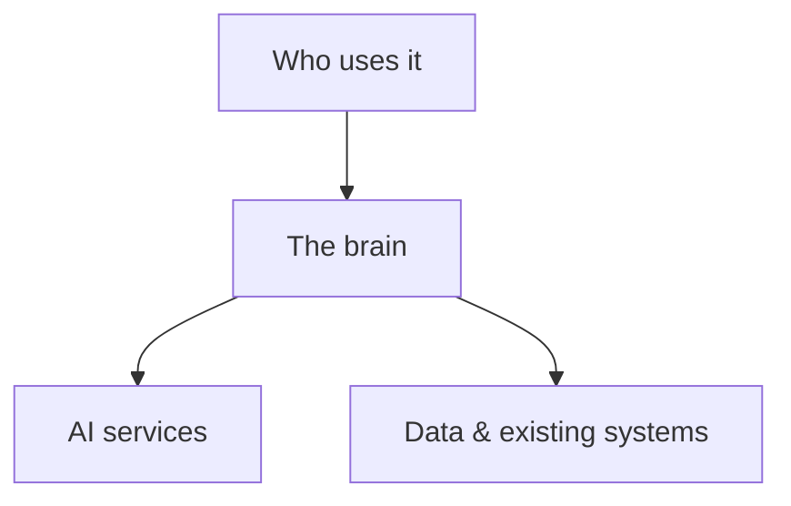

# PLAN — <idea name>

> Summary: MVP journey = <…>. Wow moment = <…>. Code freeze <time>.

## MVP journey

## Wow moment

## Build / Mock / Cut
| Feature | Build | Mock (labelled) | Cut (roadmap) |
|---|---|---|---|

## Tech stack
| Layer | Tool | Why | Fallback |
|---|---|---|---|

## Architecture

## Team
| Member | Skills | Hours available |
|---|---|---|

Hours until code freeze: <n>

## Tasks
| ID | Task | Owner | Skills needed | Hours | Depends on | Status |
|---|---|---|---|---|---|---|

Status: todo · doing · done · blocked · maybe (conditional: not counted until you decide). Keep each task under 4 h; split bigger ones.

## Plan check
<paste the output of scripts/plan_check.py>

## Timeline
| Hour | Task | Owner | Checkpoint |
|---|---|---|---|

## Freeze times
- Feature freeze:
- Code freeze:
- Deck freeze:
- Backup demo recorded by:

## 90-second demo script
| Time | What we show | What we say |
|---|---|---|
| 0:00–0:10 | Hook | |
| 0:10–0:20 | Persona | |
| 0:20–1:00 | Live journey + wow | |
| 1:00–1:15 | Safety / human check | |
| 1:15–1:30 | Impact (targets) + motto | |

## Failure scenarios
| Failure | Fallback | Backup demo path |
|---|---|---|

## Backup plan

## AI test cases
| # | Input | Expected behaviour |
|---|---|---|
