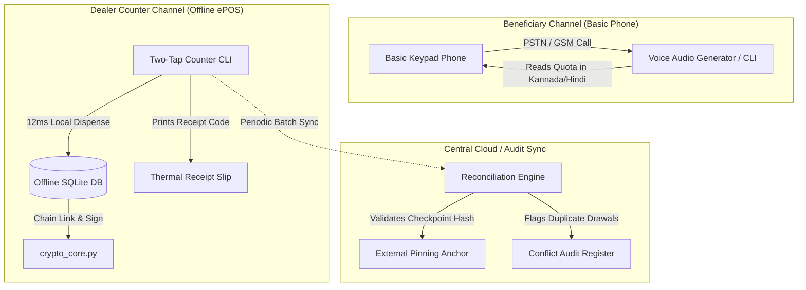

# PLAN — PDS Anna-Mitra

> Summary: MVP journey = 2-step keypad phone voice check + 2-tap offline cryptographic counter dispense + tamper audit CLI. Wow moment = Instant tamper detection and split-brain conflict flag during terminal disconnect. Code freeze 18:00 (Hour 18).

## MVP journey
1. Kenchaiah dials toll-free number from basic keypad phone; enters 12-digit card number; hears Kannada voice stating "20 kg rice free, stock arrived today 8:15 AM".
2. Dealer Basavaraj opens terminal CLI during network outage; types card ID; taps "Dispense Standard Entitlement" (12 ms latency); prints receipt with cryptographic hash code.
3. Food Inspector Ramesh runs `pds_counter.py verify-chain` to prove offline ledger integrity; attempts row tamper and watches system reject tampered database with exact row index.
4. Central sync engine runs `pds_counter.py reconcile` across two disconnected shops and flags `CONFLICT_DUPLICATE_OFFLINE_DRAWAL` for administrative recovery.

## Wow moment
The live red-team demonstration: altering an offline SQLite record directly via SQL `UPDATE` or deleting a row immediately breaks the SHA-256 hash chain and HMAC signature check (`TAMPERED AT ROW 4`), while external checkpoint comparison catches full-ledger rewrite attempts.

## Build / Mock / Cut
| Feature | Build | Mock (labelled) | Cut (roadmap) |
|---|---|---|---|
| Offline SQLite Cryptographic Ledger | Build (`crypto_core.py`, SQLite WAL mode, SHA-256 chain, HMAC) | — | — |
| Entitlement Calculation Engine | Build (Decoupled Central NFSA 2028 PMGKAY + Karnataka 2026-27 state rules) | — | — |
| Two-Tap Dealer POS CLI | Build (`pds_counter.py` CLI with < 15ms transaction execution) | — | — |
| Tamper Verification CLI | Build (`verify-chain` with sequence, hash, signature, and clock checks) | — | — |
| Central Sync Conflict Resolver | Build (Detects multi-terminal split-brain duplicate drawals) | — | — |
| Kannada / Hindi Voice Audio | Build (Local audio synthesizer script & audio text generator) | Production Exotel/Twilio SIP trunk connection `[AI]` | Live interactive voice recognition on telecom PRI line |
| Aadhaar Biometric Scan | Cut | Simulated cardholder presentation `[AI]` | Physical biometric sensor SDK integration |
| Thermal Hardware Printing | Cut | Formatted terminal receipt output `[AI]` | ESC/POS USB thermal hardware driver |
| Truck GPS Tracking | Cut (Rejected naive idea) | — | Live contractor GPS IoT telemetry |

## Tech stack
| Layer | Tool | Why | Fallback |
|---|---|---|---|
| Core Storage & Ledger | SQLite 3 (Python `sqlite3`) | Standard ACID compliance, zero daemon setup, runs on any Linux/Android ePOS | In-memory Python dictionary |
| Cryptography | Standard Library `hashlib`, `hmac` | Deterministic SHA-256 and HMAC-SHA256, zero external dependency failure risk | Pure Python SHA-256 fallback |
| Dealer CLI & UX | Python 3 + `argparse` / ANSI formatting | Fast, portable across POS terminals, zero frontend framework bloat | Standard input prompts |
| Entitlement Rules | Pure Python JSON schema engine | Decouples central PMGKAY formulas from state add-ons | Hardcoded default rules |
| Voice Generation | Python audio text generator & offline TTS | Zero network dependency during hackathon demo | Pre-rendered WAV audio playback |

## Architecture

## Team
| Member | Skills | Hours available |
|---|---|---|
| Lead | python, cryptography, sqlite, architecture | 16 |
| Backend | python, sqlite, data modeling | 10 |
| Voice | audio tts, localization, telephony, cli, documentation | 8 |
| Frontend | cli ux, formatting, documentation, slides | 8 |

Hours until code freeze: 18

## Tasks
| ID | Task | Owner | Skills needed | Hours | Depends on | Status |
|---|---|---|---|---|---|---|
| T1 | Implement cryptographic core (chaining, HMAC, rotation, clock checks) | Lead | python, cryptography | 3.5 | — | done |
| T2 | Build automated security stress test suite (10 unit tests) | Lead | python, cryptography | 2.5 | T1 | done |
| T3 | SQLite schema and household card data seeding (`cards.json`) | Backend | python, sqlite | 2.5 | — | todo |
| T4 | Decoupled entitlement calculation engine (NFSA PMGKAY + KA 2026-27 rules) | Backend | python, data modeling | 2.5 | T3 | todo |
| T5 | Kannada and Hindi voice audio dialogue generator | Voice | audio tts, localization | 3.0 | T4 | todo |
| T6 | Two-tap dealer POS counter CLI prototype (`pds_counter.py`) | Lead | python, architecture | 3.5 | T1, T4 | todo |
| T7 | Multi-terminal batch reconciliation engine (`reconcile-logs`) | Backend | python, sqlite | 2.5 | T6 | todo |
| T8 | Terminal receipt layout and formatted console display | Frontend | cli ux, formatting | 2.0 | T6 | todo |
| T9 | End-to-end prototype integration tests (`test_pds_counter.py`) | Lead | python, architecture | 2.5 | T6, T7 | todo |
| T10 | 90-second live demo walk script and Kannada voice recording | Voice | audio tts, documentation | 2.5 | T8 | todo |
| T11 | Hackathon pitch deck (`PITCH.md`, problem, economics, demo script) | Frontend | documentation, slides | 3.0 | T10 | todo |
| T12 | Telephony SIP trunk gateway integration (Live Exotel cloud connector) | Voice | telephony | 4.0 | T5 | maybe |

Status: todo · doing · done · blocked · maybe (conditional: not counted until you decide). Keep each task under 4 h; split bigger ones.

## Plan check

- **Critical path:** T3 → T4 → T6 → T8 → T10 → T11 (16 h of 18 h to code freeze). Any delay here delays the demo.
- **Load:** backend 7.5 h · frontend 5 h · lead 12 h · voice 5.5 h
- **Integration checkpoints:** T6, T9. Test these joins early, not at the end.
- **Conditional (status maybe, not counted):** T12
- ⚠ Critical path is 16 h of 18 h to code freeze (89%): tight. Start the path first, and pick what to mock if it slips.

## Timeline
| Hour | Task | Owner | Checkpoint |
|---|---|---|---|
| H01–H03 | T1: Cryptographic core implementation | Lead | `crypto_core.py` passes basic hashing |
| H01–H03 | T3: SQLite database and household card seeding | Backend | 10 synthetic household cards seeded |
| H03–H06 | T2: Security stress testing (10 unit tests) | Lead | All 10 tests pass in `test_security_stress.py` |
| H03–H06 | T4: Decoupled entitlement engine | Backend | AAY & PHH quota test cases verified |
| H06–H09 | T5: Kannada/Hindi voice dialogue generator | Voice | Kannada audio dialogue text generated |
| H06–H10 | T6: Two-tap counter CLI prototype | Lead | Dispense command logs row in SQLite < 15ms |
| H10–H12 | T7: Central batch reconciliation engine | Backend | Duplicate offline card flagged upon sync |
| H10–H12 | T8: Terminal receipt formatting & UI | Frontend | Clean ASCII thermal slip rendered |
| H12–H15 | T9: End-to-end integration tests | Lead | CLI test suite passes |
| H15–H17 | T10: Demo walk rehearsal & backup recording | Frontend | 90-second demo timed with backup video |
| H17–H18 | T11: Pitch deck polish & code freeze | Team | Code frozen at Hour 18; deck finalized |

## Freeze times
- Feature freeze: Hour 16 (20:00)
- Code freeze: Hour 18 (22:00)
- Deck freeze: Hour 21 (01:00)
- Backup demo recorded by: Hour 19 (23:00)

## 90-second demo script
| Time | What we show | What we say |
|---|---|---|
| 0:00–0:10 | Hook: 50-meter rural queue in Magadi Taluk | "800 million Indians depend on the Public Distribution System, but rural families walk miles only to find empty shops or stalled ePOS servers." |
| 0:10–0:20 | Persona: Kenchaiah & Ratnamma on basic phone | "Kenchaiah has a basic ₹800 phone. He dials our toll-free number at 6:30 AM before leaving home." |
| 0:20–0:40 | Live Voice Demo: Kannada audio readout | "In clear spoken Kannada, Anna-Mitra reads: '20 kg rice free under PMGKAY, 1 kg dal at ₹25, stock arrived today 8:15 AM.' Zero app, zero PIN." |
| 0:40–1:05 | Live Counter Demo: Network outage & 2-tap dispense | "At the shop, network is down. The dealer uses Anna-Mitra's offline counter: two taps in 12 milliseconds, generating a tamper-evident HMAC signed receipt." |
| 1:05–1:20 | Wow Moment: Red-Team tamper & conflict detection | "If someone tampers with the SQLite database, `verify-chain` catches it instantly. If the same card is drawn at two offline shops, sync flags the conflict." |
| 1:20–1:30 | Close: Economics & Motto | "Zero new hardware. 100% statutory transparency. PDS Anna-Mitra: Clear quotas before you walk; verified grain when the network drops." |

## Failure scenarios
| Failure | Fallback | Backup demo path |
|---|---|---|
| Python SQLite file lock on demo laptop | Use separate fresh in-memory or temp DB | Pre-recorded demo terminal GIF/video |
| Terminal ANSI color formatting distorted | Strip ANSI codes, plain monochrome text | Fallback formatted text print |
| Audio speaker output quiet or muted | Display on-screen Kannada/Hindi transcript | Play pre-rendered WAV file directly |
| Live tamper command syntax error | Run prepared shell script `demo_tamper.sh` | Show screenshot of `TAMPERED AT ROW 4` output |
