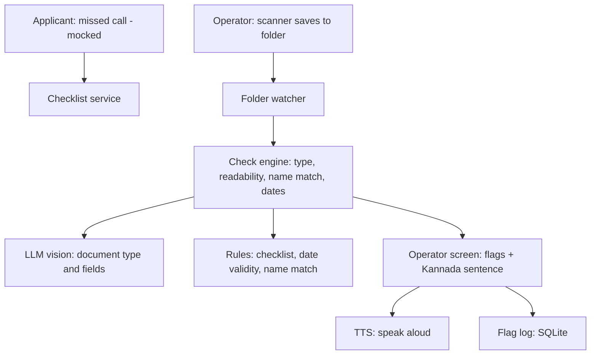

# Mock Social Good Hack (test run)

> One trip, not three.

## Contents

1. Executive summary
2. Assumptions
3. Locked core
4. MVP plan
5. Solution trial and checks
6. Pitch and judge Q&A

# SUMMARY — One trip

> One trip, not three.

| | |
|---|---|
| Event / track | Mock Social Good Hack (test run) · S2 certificates |
| Team | A (captain, backend), B (frontend), C (AI), D (design + pitch) |
| Latest decision | INCONCLUSIVE · NG 5 · G 0 · IE 7 (full trial) · rubric estimate 68/100 |
| Idea | CORE v2 · combination of process shift + access shift |

## Problem
A rejected certificate application must be filed again from scratch ([Odisha e-District FAQ](https://edistrictapp.odisha.gov.in/fr/faq)), and a Karnataka income certificate takes up to 21 days in person ([tumkur.nic.in](https://tumkur.nic.in/?p=25892)).

## Solution
A missed-call checklist by purpose, plus a 30-second (target) check on the operator's existing scans that flags missing, unreadable or mismatched documents and explains them aloud in Kannada. Flags only; the operator decides; nothing is stored.

## Journey
1. Missed call → checklist in Kannada (mocked)
2. Operator scans as usual into a watched folder
3. Check auto-runs: type, readability, name match, dates
4. Operator plays the Kannada explanation
5. One submission

## What's built vs mocked
| Built | Mocked |
|---|---|
| Folder watcher, checks, operator screen, Kannada TTS, flag log | Missed-call line, SMS |

## Top ratings
| Item | /10 |
|---|---|
| Problem is real | 8 |
| Safe | 8 |
| Buildable and demo-able | 7 |

## Open assumptions (collapses / weakens)
| Assumption | Status |
|---|---|
| Document problems cause most rejections | testing (experiment 1) |
| Operators will run the check | testing (experiment 2) |

## Next steps
1. Phone 3 operators (experiment 1)
2. Add the eligibility warning if experiment 1 fails
3. Pre-test real scans; record the backup demo

# ASSUMPTIONS — Certificate pre-check (S2)

> Summary: 8 open · 2 testing · 0 validated · 0 rejected · 2 "collapses" still open

## Test-first list
1. Document problems cause most rejections (collapses)
2. CSC operators will add a pre-check step (collapses)
3. Document photos can be checked reliably enough (weakens)

## All assumptions
| # | Assumption | Importance | Team confidence | Evidence (label) | Kill test | How to test | Pass if / fail if | Status | Updated | Source |
|---|---|---|---|---|---|---|---|---|---|---|
| 1 | Document problems cause most rejections (vs Tahsildar verification, eligibility) | critical | medium | [?] (no public data found) | collapses | Experiment 1 | Pass: 6+ of 10 are document issues · Fail: most are verification/eligibility | testing | 10:20 | court pick-s2 |
| 2 | CSC operators will add a pre-check step | critical | low | [?] | collapses | Experiment 2 | Pass: 2 of 3 say yes · Fail: 2 of 3 say no | testing | 10:20 | court pick-s2 |
| 3 | Document photos can be checked reliably enough | high | medium | [AI] | weakens | Run 10 sample documents through the checker | Pass: 8 of 10 correct flags · Fail: under 6 | open | 10:20 | pick |
| 4 | Applicants learn of rejection only after days, not at the counter | medium | medium | [AI] | weakens | Ask operators how long status takes | Pass: several days typical | open | 10:30 | users |
| 5 | Farm labourers lack standard income proof, causing rejections | high | medium | [AI] | weakens | Open the Karnataka income certificate checklist; ask an operator | Pass: self-declaration rules are unclear or often rejected | open | 10:30 | users |
| 6 | Applicants will call the checklist line before their first trip | high | low | [AI] | weakens | Ask 5 students at the venue if they would | Pass: 3 of 5 say yes and know when they need one | open | 10:45 | ideate |
| 7 | Name matching works across Kannada/English spellings | high | medium | [AI] | weakens | Test 10 name pairs | Pass: 9 of 10 correct | open | 10:45 | ideate |
| 8 | Many applicants lack the needed documents in DigiLocker | high | medium | [AI] | weakens | Ask 5 students whether their parents' documents are in DigiLocker | Pass: 3 of 5 say no | open | 11:10 | compete |
| 9 | Applicants can name the purpose even if not the certificate | medium | high | [AI] | weakens | Ask 5 students what they'd say | Pass: 4 of 5 name the purpose | open | 11:20 | stress |
| 10 | The check runs in under 30 s on existing scans | high | medium | [AI] | weakens | Time it on the prototype | Pass: under 30 s for 5 documents | open | 11:20 | stress |

- Kill test: **collapses** (the idea fails if this is false) · weakens · minor.
- Status: open · testing · validated (needs `[V]` or `[T]`) · rejected.
- Source: where it came from (users, ideate, stress, court <case>, team).

## Status history
| Date time | # | From → to | Evidence added | By |
|---|---|---|---|---|
| Day 1 11:00 | 1 | open → testing | Experiment 1 planned; no public rejection data found | Team |
| Day 1 11:00 | 2 | open → testing | Experiment 2 planned | Team |

# CORE — One trip

> LOCKED: Day 1 11:40 IST · Version v2 · risk logged: 2 "collapses" assumptions untested

> Summary: a counter-side pre-check and spoken checklist so certificate applicants find out what's missing before they submit.

Version: v2

## 1. Name and motto
**One trip.** "One trip, not three."

## 2. Positioning line
For first-time and low-literacy applicants who lose trips to rejected certificate applications, One trip is a counter-side pre-check that tells them what's missing before they submit.

## 3. Problem (2 lines + strongest sourced number)
In Odisha, a rejected certificate application can't be revived; you apply again from scratch ([V] Odisha e-District FAQ). In Karnataka, an income certificate takes up to 21 days by the in-person route ([V] tumkur.nic.in), so a rejection costs weeks.

## 4. Persona story — before vs after
| Before | After |
|---|---|
| Lakshmi brings what her father thinks is needed | She gives a missed call, says "income certificate" and hears the exact list in Kannada |
| The operator uploads; she's rejected 10 days later | The operator's scans get a 30-second check: "income proof missing, father's name spelled differently" |
| She starts again and nearly misses the scholarship | She returns the next morning with the right paper; one submission |

## 5. End-to-end journey
| # | Who acts | Channel / device | System does | Human decides |
|---|---|---|---|---|
| 1 | Applicant | Missed call / WhatsApp voice | Calls back, asks **what it's for** (scholarship, job, scheme), maps that to the certificate, reads the checklist aloud in Kannada, and SMSes it to a family number | — |
| 2 | Applicant | CSC counter | — | Brings documents |
| 3 | Operator | Drag the existing scan folder (PDF/JPG) | In under 30 s: checks type, readability, name match across documents, date validity, and that the income proof matches the declared income band | — |
| 4 | System → operator | One screen | Shows "looks complete" or "possible issue, please check" per document, with a Kannada sentence to read aloud. Never says "approved" | Operator decides to submit or ask for more |
| 5 | Operator | Seva Sindhu (unchanged) | — | Submits |

## 6. Who does what
| Role | Does | Never has to |
|---|---|---|
| Applicant | Calls once, brings documents | Install an app, read or type |
| Operator | Clicks "check" on scans they already made | Re-photograph documents |
| Verifying officer | Nothing changes | Use a new system |

## 7. USPs (each tied to a user pain)
1. Find out before submitting, not days later.
2. Spoken Kannada: no reading needed.
3. Uses the operator's existing scans: no extra photos.
4. Flags only, never blocks: the operator stays in charge.
5. Honest scope: catches document-caused rejections, not field verification or eligibility.

## 8. AI vs rules vs humans
| Step | AI does | Fixed rules do | Human decides | If AI fails |
|---|---|---|---|---|
| Checklist | — | Checklist config file per certificate, with a "last checked" date | — | Printed card |
| Document type | Classifies the scan | — | Operator confirms | Operator ticks manually |
| Name match | Fuzzy match across scripts | Exact-match fallback | Operator confirms | Operator compares by eye |
| Date validity | Reads the date | Rule: income proof within 1 year | Operator | Manual |

## 9. Inclusion (least-digital user)
Spoken checklist on a missed call; the operator reads results aloud; no phone needed at the counter.

## 10. Fit with existing systems (levels 0–3)
L0 standalone · L1 DigiLocker fetch when the citizen consents (covers documents already there; we still check self-declarations and new documents) · L2 summary attached · L3 built into Seva Sindhu.

## 11. Privacy basics
Scans are processed in memory and never stored; Aadhaar numbers are masked on screen and in logs; nothing is sent to the portal by us. Shown live in the demo.

## 12. Out of scope
Approving applications, field verification, eligibility decisions, judging whether a self-declared income is believable, filing on the portal.

## 13. Open assumptions
| Assumption | Label | Kill test | Status |
|---|---|---|---|
| Document problems cause most rejections | [?] | collapses | testing (experiment 1) |
| Operators will run the check | [?] | collapses | testing (experiment 2) |
| Check runs in under 30 s on existing scans | [AI] | weakens | open |
| Applicants can name the purpose | [AI] | weakens | open |

# PLAN — One trip

> Summary: MVP journey = Lakshmi's income-certificate check at the counter. Wow moment = a name mismatch caught and explained aloud in Kannada in under 30 s. Code freeze Day 2 06:00 IST.

## MVP journey
Lakshmi gives a missed call → hears the income certificate checklist in Kannada (recorded clip, mocked call) → at the counter, the operator saves her scans into the watched folder → the check auto-runs → one screen flags "father's name spelled differently on ration card" and "income proof missing" → the operator presses ▶ to read it aloud in Kannada → a log records the flags and the operator's decision.

## Wow moment
Three scan sets side by side (clean, blurry, name mismatch); the mismatch is caught and spoken in Kannada in under 30 s.

## Build / Mock / Cut
| Feature | Build | Mock (labelled) | Cut (roadmap) |
|---|---|---|---|
| Checklist per purpose (scholarship → income certificate) | ✓ config file | | Other certificates |
| Watched scan folder + auto-run | ✓ | | |
| Document type + readability check | ✓ | | |
| Name match across documents (Kannada/English) | ✓ (transliteration + fuzzy match) | | |
| Date validity rule | ✓ | | |
| Spoken Kannada sentence (TTS) | ✓ (sponsor speech API) | | |
| Missed-call callback | | ✓ recorded clip + simulated callback | Real telephony |
| SMS to family number | | ✓ shown on screen | Real SMS |
| Flag log for accountability | ✓ | | |
| DigiLocker fetch | | | ✓ L1 roadmap |

## Tech stack
| Layer | Tool | Why | Fallback |
|---|---|---|---|
| Operator screen | React + Tailwind | Team strength (B) | Static HTML |
| Backend + folder watcher | FastAPI + watchdog | Team strength (A) | Manual upload button |
| OCR / classification | Vision-capable LLM on the scan | Handles mixed Kannada/English layouts | Manual tick list |
| Name matching | Transliteration + fuzzy match (rules) | Deterministic, explainable | Operator compares by eye |
| Speech | Sponsor Indian-language TTS | Kannada voice, sponsor bonus | Pre-recorded clips |
| Storage | None for scans (in memory); SQLite for the flag log | Privacy | — |

## Architecture

## Timeline
| Hour | Task | Owner | Checkpoint |
|---|---|---|---|
| 11:45–12:15 | **Experiments 1 and 2: phone 3 operators** | D + A | Tally rejection reasons |
| 12:00–15:00 | Folder watcher + check engine skeleton | A | Seeded scans run end to end |
| 12:00–15:00 | Operator screen | B | Flags render |
| 12:00–16:00 | Vision extraction + name matching | C | 9 of 10 test pairs match |
| 16:00–19:00 | TTS + flag log | C + A | Kannada sentence plays |
| 19:00–23:00 | Integrate; three seeded scan sets | All | Full journey under 30 s |
| 23:00–02:00 | Polish, failure fallbacks | All | Offline mode works |
| 02:00–06:00 | Deck, demo recording | D (+ all) | Backup video saved |

## Freeze times
- Feature freeze: 23:00
- Code freeze: Day 2 06:00
- Deck freeze: Day 2 08:30
- Backup demo recorded by: Day 2 06:30

## 90-second demo script
| Time | What we show | What we say |
|---|---|---|
| 0:00–0:10 | Hook | "In Odisha, a rejected certificate application can't be revived. You start again, and a Karnataka income certificate takes up to 21 days." |
| 0:10–0:20 | Persona | Lakshmi, 19, scholarship deadline in 3 weeks |
| 0:20–1:00 | Live journey + wow | Recorded missed call → scans saved → mismatch caught → Kannada read aloud |
| 1:00–1:15 | Safety / human check | "It never says approved. The operator decides. Scans are never stored." |
| 1:15–1:30 | Impact (targets) + motto | "Target: fewer document rejections, to be measured. One trip, not three." |

## Backup plan
Recorded video of the full journey; seeded scans bundled locally; TTS clips pre-generated; a manual tick list if the vision API fails.

## Failure scenarios (from STRESS.md)
| Failure | Fallback | Backup demo path |
|---|---|---|
| No internet | Offline checklist + manual ticks | Pre-generated results for the seeded scans |
| Vision/TTS API down | Rules-only checks + recorded clips | Recorded video |
| Wrong AI answer | Flag-only; the operator confirms | Show a false flag being overridden |
| Applicant doesn't answer the callback | SMS checklist to a family number (mocked) | Show the SMS on screen |

## AI test cases
| # | Input | Expected behaviour |
|---|---|---|
| 1 | Clean set: Aadhaar, ration card, income self-declaration | "Looks complete" |
| 2 | Blurry ration card | "Ration card not readable, please rescan" |
| 3 | Name "Lakshmi K" vs "Laxmi Kumari" | "Possible name difference, please check": not auto-failed |
| 4 | Kannada-script name vs English-script name | Transliterated match → pass |
| 5 | Income proof from 2023 | "Income proof may be too old" (rule) |
| 6 | Missing income proof | "Income proof missing" |
| 7 | Random photo (not a document) | "Not a recognised document" |
| 8 | Aadhaar number visible | Masked on screen and in the log |
| 9 | Unsupported certificate type | "Checklist not available: use the printed card" (hand over to human) |
| 10 | Empty folder | No crash; "No scans found" |

# VERDICT — One trip, planned MVP (full trial)

> Summary: INCONCLUSIVE · NOT GUILTY 5 · GUILTY 0 · INSUFFICIENT EVIDENCE 7 · 12 of 12 valid votes · rubric estimate 68/100

**DECISION: INCONCLUSIVE.** The jury won't decide until experiment 1 runs. Nobody voted GUILTY.
On trial: "Does this solution, as planned, solve the real problem for its real users?"
Jury: civic seats (Government clerk, Policy officer, Citizen advocate in seats 4, 5, 9) · full 12
Average confidence: 5.5/10 (how sure jurors were, not a probability of success)

> Simulated jurors are perspectives, not real users or experts. Use this verdict to decide what to test and fix, not as proof.

## Votes
| # | Juror | Vote | Conf | Evidence | Reason |
|---|---|---|---|---|---|
| 1 | Actual end user | INSUFFICIENT EVIDENCE | 5 | weak | Real pain [V]; unknown whether documents cause most rejections |
| 2 | Least-digital user | NOT GUILTY | 5 | medium | No app, typing or English; the pre-visit call is mocked |
| 3 | Front-line worker | INSUFFICIENT EVIDENCE | 5 | weak | Few taps, but speed and false flags untested |
| 4 | Government clerk | INSUFFICIENT EVIDENCE | 6 | weak | Logging helps; operator uptake untested |
| 5 | Policy officer | NOT GUILTY | 5 | medium | Advisory, needs no portal; fits the rules |
| 6 | Root-cause analyst | INSUFFICIENT EVIDENCE | 6 | weak | Eligibility and Tahsildar causes untouched |
| 7 | "Already exists" researcher | INSUFFICIENT EVIDENCE | 5 | weak | Checklists exist; no prior-art scan in the case |
| 8 | Safety and ethics reviewer | NOT GUILTY | 5 | medium | Human decides, logged, masked; false-confidence risk |
| 9 | Citizen advocate (NGO) | INSUFFICIENT EVIDENCE | 6 | weak | Outreach before the visit is mocked |
| 10 | Engineer | NOT GUILTY | 6 | medium | Buildable in 22 h; name matching is the demo risk |
| 11 | Statement-owner judge | NOT GUILTY | 6 | medium | Answers the statement directly |
| 12 | Sceptic | INSUFFICIENT EVIDENCE | 6 | weak | Both killer assumptions are [?] |

No vote or invalid: none. Raw votes: `court/verify/votes-raw.json`.

## Contradictions between jurors
| Jurors | Disagreement | Evidence favours |
|---|---|---|
| Researcher vs citizen advocate | "Drop the pre-visit call (duplicates existing lists)" vs "make the pre-visit call real" | Advocate: existing lists are English and online [V-guide]; the call reaches non-readers. Keep it, but in L1 |
| Least-digital user vs front-line worker | "Fits me" vs "untested at rush hour" | Both right; experiment 2 decides |

## Ratings /10
| Item | Score | Why (labels) |
|---|---|---|
| Problem is real | 8 | Rejection means starting again [V], 21 days [V] |
| Problem matters | 6 | Frequency unknown [?] |
| Solution fits the root cause | 5 | Covers document causes only; eligibility untouched |
| Works for real users | 6 | Least-digital fit good; operator uptake [?] |
| Fits existing systems | 7 | In front of the portal, no integration |
| Safe | 8 | Flags only, logged, masked |
| Buildable and demo-able | 7 | One journey; name matching risky [AI] |
| Different from what exists | 5 | Checklists exist; the moment and the voice are the difference |

## What's genuinely strong
1. The cost of a rejection is verified [V]: start again, up to 21 days.
2. Safety design: the operator decides, nothing says "approved", scans aren't stored.

## Weakest assumption
Document problems cause most rejections — [?] — kill test: **collapses** (named by 9 of 12 jurors)

## What we're overlooking
- **Eligibility:** 4 jurors independently suggested warning about likely ineligibility (an income limit for the purpose) before submission. This is a rejection cause the document check can't catch.
- No prior-art scan of existing pre-check tools was given to the jury.

## An alternative approach (same problem, same user)
- A purpose-first "Am I eligible, and what do I bring?" voice line, with the counter check as an add-on.

## Ranked improvements
| # | Change | Impact | Effort | Priority | Raised by | Inside the core? | How to check it worked |
|---|---|---|---|---|---|---|---|
| 1 | Run experiment 1 (operators tally rejection reasons) | high | low | P0 | 9 jurors | yes | 6+ of 10 document-caused |
| 2 | Run experiment 2 (timed counter run, false flags) | high | low | P0 | Front-line worker, clerk | yes | Under 30 s, few false flags |
| 3 | Rules-based eligibility warning (income limit by purpose) | high | medium | P1 | Root-cause, end user, advocate, sceptic | yes (adds a check, same user and journey) | Warns on a test case over the limit |
| 4 | Say aloud: "eligibility and the Tahsildar's decision aren't checked" | high | low | P1 | Safety reviewer | yes | Spoken in the demo |
| 5 | Pre-test on real sample scans; cache TTS; backup video | high | low | P1 | Engineer | yes | Demo runs offline |

## Next experiment (30 min)
Test: phone 3 Nadakacheri/CSC operators; tally their last 10 rejections by reason.
PASS if: 6+ of 10 are document issues for at least 2 operators.
FAIL if: most are eligibility or Tahsildar decisions → pivot the core check to the eligibility warning.

## If I were your team…
Make the three phone calls now. The answer decides whether you build a document checker or an eligibility checker.

## Rubric estimate (strict judge; an estimate, not a prediction)
| Criterion | Weight | Score /10 | Why | One thing that raises it |
|---|---|---|---|---|
| Problem understanding | 25 | 7 | Cost of rejection verified | Real rejection-cause data |
| Innovation | 25 | 6 | Moment + voice; checklists exist | Eligibility + document check together |
| Feasibility | 20 | 8 | One honest journey | Real scans pre-tested |
| Impact | 20 | 6 | Frequency unknown | Experiment 1 numbers |
| Presentation | 10 | 7 | Clear persona | Live mismatch caught on stage |
| **Total** | | **68/100** | | |

## Mistakes check
✅ problem-first · ✅ no app · ✅ least-digital user · ✅ AI never decides · ✅ competitors named · ✅ numbers labelled · ✅ no drift · ✅ one journey · ✅ backup demo planned · ⚠️ slides not made yet · ⚠️ #11: two "collapses" assumptions still `[?]`; don't present the jury as proof · ✅ more than one idea considered

## Claims check
| Claim | Status |
|---|---|
| Rejection means starting again (Odisha) | [V] |
| 21 days (Karnataka in person) | [V] |
| "Under 30 s" | [AI]: present as a target |
| "Catches most rejections" | ❌ unsupported: removed; say "catches document-caused rejections" |

**Next →** `/hack:assumptions` and experiment 1, then continue to `/hack:pitch`

# PITCH — One trip

> Summary: "Find out what's wrong with your certificate application before you submit, not 21 days later." · 6 slides · 4-min pitch

## One-liners
- **One-line pitch:** One trip tells certificate applicants what's missing before they submit, spoken in Kannada at the counter.
- **Opening line (Problem 25% + Innovation 25%):** "In Odisha, a rejected certificate application can't be revived. You start again. We move the moment of truth from 21 days later to the counter."
- **Motto:** One trip, not three.

## Deck outline (stay within the slide limit)
| # | Headline (full sentence) | 3–5 short items | Visual | Source line |
|---|---|---|---|---|
| 1 | A rejected application means starting again, and losing weeks | Lakshmi, 19 · scholarship deadline · 21 days | Persona + timeline | Odisha e-District FAQ; tumkur.nic.in |
| 2 | Applicants only find out what was wrong after the rejection | Status after review · English guides · repeat trips | Before/after timeline | CitizenNest (low reliability) |
| 3 | One trip checks documents at the counter, before submission | Existing scans · 30 s target · spoken Kannada · never "approved" | Operator screen mock | — |
| 4 | Live: a name mismatch caught and explained aloud | Clean / blurry / mismatch | Demo | — |
| 5 | Built safely: the operator decides, nothing is stored | Flags only · log · Aadhaar masked · fallbacks | Architecture | — |
| 6 | What we tested, what we haven't, and what's next | Experiment results · eligibility warning · DigiLocker L1 | Assumptions table | — |

Rules: no heavy text · readable fonts · only [V]/[T] claims stated as facts · "under 30 s" shown as a target.

## Form answers
| Question | Word limit | Answer |
|---|---|---|
| What problem are you solving? | 150 | Certificate applications for income, caste and residence are often rejected for document problems, and a rejected application must be filed again from scratch (Odisha e-District FAQ). In Karnataka an income certificate can take up to 21 days in person, so one missing paper can cost a student a scholarship deadline. Applicants learn what was wrong only after the rejection, usually in English and online. We help the people who rely on a CSC operator, and who can't read the rejection reason, find out at the counter, before submission. |
| What is innovative? | 150 | Checklists already exist; what doesn't exist is a check at the moment of submission, spoken in the applicant's language. One trip runs on the scans the operator already makes, flags missing, unreadable or mismatched documents in under 30 seconds (target), and plays a Kannada explanation. It never approves anything: the operator decides, every flag is logged, and scans are never stored. |

## Judge Q&A
| Question | Answer (2–3 lines) |
|---|---|
| How many rejections are document problems? | We found no public data. We asked operators (experiment 1): [result]. If it's low, our eligibility warning covers the next biggest cause. |
| What if the AI is wrong? | It only flags; the operator confirms every flag. It never says "approved". Wrong flags are logged so we can measure them. |
| Doesn't DigiLocker solve this? | For documents already in DigiLocker, partly. Self-declarations and new documents aren't there, and we add DigiLocker fetch as level 1. |
| Why would operators use it? | It runs on the folder they already save scans to: no extra clicks. Fewer angry repeat customers. Experiment 2: [result]. |
| What did you build vs mock? | Built: folder watcher, checks, operator screen, Kannada TTS, flag log. Mocked: the missed-call line and SMS. |
| How does a person who can't read use it? | The operator plays the Kannada sentence aloud; before the visit, a missed call reads the checklist. |
| What about privacy? | Scans are processed in memory and never stored; Aadhaar numbers are masked on screen and in logs. |
| Isn't this just OCR? | The OCR is a commodity. The difference is when the check happens (before submission) and who it serves (non-readers, through the operator). |
