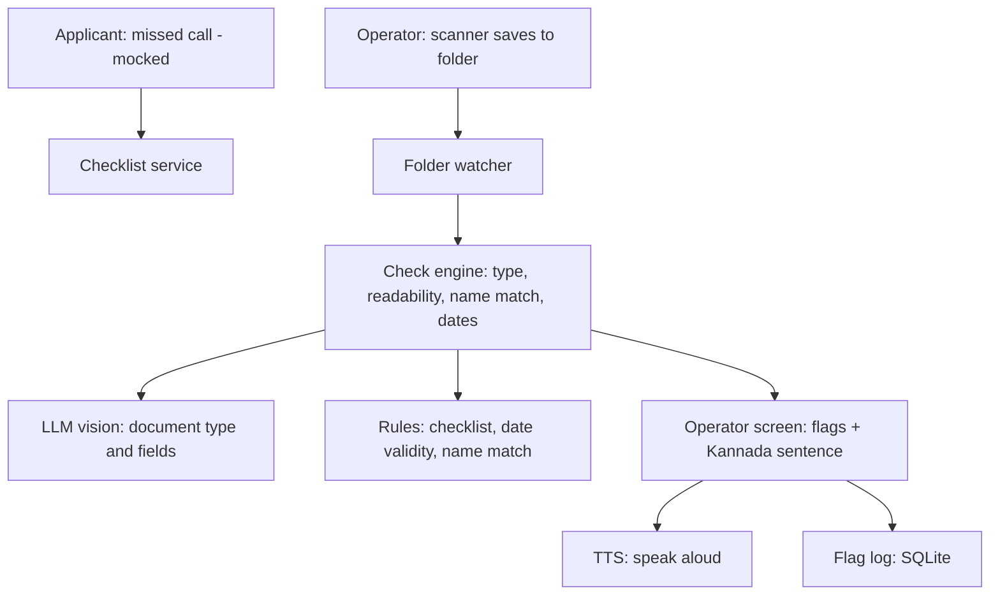

# PLAN — One trip

> Summary: MVP journey = Lakshmi's income-certificate check at the counter. Wow moment = a name mismatch caught and explained aloud in Kannada in under 30 s. Code freeze Day 2 06:00 IST.

## MVP journey
Lakshmi gives a missed call → hears the income certificate checklist in Kannada (recorded clip, mocked call) → at the counter, the operator saves her scans into the watched folder → the check auto-runs → one screen flags "father's name spelled differently on ration card" and "income proof missing" → the operator presses ▶ to read it aloud in Kannada → a log records the flags and the operator's decision.

## Wow moment
Three scan sets side by side (clean, blurry, name mismatch); the mismatch is caught and spoken in Kannada in under 30 s.

## Build / Mock / Cut
| Feature | Build | Mock (labelled) | Cut (roadmap) |
|---|---|---|---|
| Checklist per purpose (scholarship → income certificate) | ✓ config file | | Other certificates |
| Watched scan folder + auto-run | ✓ | | |
| Document type + readability check | ✓ | | |
| Name match across documents (Kannada/English) | ✓ (transliteration + fuzzy match) | | |
| Date validity rule | ✓ | | |
| Spoken Kannada sentence (TTS) | ✓ (sponsor speech API) | | |
| Missed-call callback | | ✓ recorded clip + simulated callback | Real telephony |
| SMS to family number | | ✓ shown on screen | Real SMS |
| Flag log for accountability | ✓ | | |
| DigiLocker fetch | | | ✓ L1 roadmap |

## Tech stack
| Layer | Tool | Why | Fallback |
|---|---|---|---|
| Operator screen | React + Tailwind | Team strength (B) | Static HTML |
| Backend + folder watcher | FastAPI + watchdog | Team strength (A) | Manual upload button |
| OCR / classification | Vision-capable LLM on the scan | Handles mixed Kannada/English layouts | Manual tick list |
| Name matching | Transliteration + fuzzy match (rules) | Deterministic, explainable | Operator compares by eye |
| Speech | Sponsor Indian-language TTS | Kannada voice, sponsor bonus | Pre-recorded clips |
| Storage | None for scans (in memory); SQLite for the flag log | Privacy | — |

## Architecture

## Timeline
| Hour | Task | Owner | Checkpoint |
|---|---|---|---|
| 11:45–12:15 | **Experiments 1 and 2: phone 3 operators** | D + A | Tally rejection reasons |
| 12:00–15:00 | Folder watcher + check engine skeleton | A | Seeded scans run end to end |
| 12:00–15:00 | Operator screen | B | Flags render |
| 12:00–16:00 | Vision extraction + name matching | C | 9 of 10 test pairs match |
| 16:00–19:00 | TTS + flag log | C + A | Kannada sentence plays |
| 19:00–23:00 | Integrate; three seeded scan sets | All | Full journey under 30 s |
| 23:00–02:00 | Polish, failure fallbacks | All | Offline mode works |
| 02:00–06:00 | Deck, demo recording | D (+ all) | Backup video saved |

## Freeze times
- Feature freeze: 23:00
- Code freeze: Day 2 06:00
- Deck freeze: Day 2 08:30
- Backup demo recorded by: Day 2 06:30

## 90-second demo script
| Time | What we show | What we say |
|---|---|---|
| 0:00–0:10 | Hook | "In Odisha, a rejected certificate application can't be revived. You start again, and a Karnataka income certificate takes up to 21 days." |
| 0:10–0:20 | Persona | Lakshmi, 19, scholarship deadline in 3 weeks |
| 0:20–1:00 | Live journey + wow | Recorded missed call → scans saved → mismatch caught → Kannada read aloud |
| 1:00–1:15 | Safety / human check | "It never says approved. The operator decides. Scans are never stored." |
| 1:15–1:30 | Impact (targets) + motto | "Target: fewer document rejections, to be measured. One trip, not three." |

## Backup plan
Recorded video of the full journey; seeded scans bundled locally; TTS clips pre-generated; a manual tick list if the vision API fails.

## Failure scenarios (from STRESS.md)
| Failure | Fallback | Backup demo path |
|---|---|---|
| No internet | Offline checklist + manual ticks | Pre-generated results for the seeded scans |
| Vision/TTS API down | Rules-only checks + recorded clips | Recorded video |
| Wrong AI answer | Flag-only; the operator confirms | Show a false flag being overridden |
| Applicant doesn't answer the callback | SMS checklist to a family number (mocked) | Show the SMS on screen |

## AI test cases
| # | Input | Expected behaviour |
|---|---|---|
| 1 | Clean set: Aadhaar, ration card, income self-declaration | "Looks complete" |
| 2 | Blurry ration card | "Ration card not readable, please rescan" |
| 3 | Name "Lakshmi K" vs "Laxmi Kumari" | "Possible name difference, please check": not auto-failed |
| 4 | Kannada-script name vs English-script name | Transliterated match → pass |
| 5 | Income proof from 2023 | "Income proof may be too old" (rule) |
| 6 | Missing income proof | "Income proof missing" |
| 7 | Random photo (not a document) | "Not a recognised document" |
| 8 | Aadhaar number visible | Masked on screen and in the log |
| 9 | Unsupported certificate type | "Checklist not available: use the printed card" (hand over to human) |
| 10 | Empty folder | No crash; "No scans found" |
